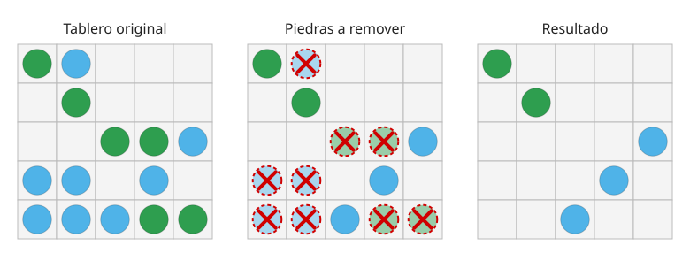
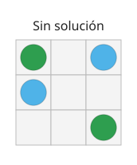


{{tp.entrega | date: "%e/%m"}}

# Trabajo Práctico 3: Diversión NP-Completa

El presente trabajo busca evaluar el desarrollo y análisis de un algoritmo 
de Backtracking para resolver un Problema NP-Completo, así como el análisis 
de posibles aproximaciones. 
La fecha de entrega del mismo es el {{fecha}}.

## Introducción

Los hermanos siguieron creciendo. Mateo también aprendió sobre programación dinámica, y cada uno aplicaba la lógica sabiendo que el otro también lo hacía. El juego de las monedas se tornó aburrido en cuánto notaron que siempre ganaba quien empezara, o según la suerte. Los años pasaron, llegó la adolescencia y empezaron a tener gustos diferentes. En general, jugaban a juegos individuales. 
En particular, Sophia estaba muy enganchada con el siguiente juego de tipo _puzzle_: El juego consiste de una grilla de $$n \times m$$ celdas. Cada celda puede estar vacía, estar ocupada por una piedra verde, o estar ocupada por una piedra celeste. El objetivo original del juego es remover algunas de las piedras de tal forma que las piedras que quedan cumplan las siguientes condiciones: 

1. Cada fila tiene al menos una piedra.
2. Ninguna columna tiene piedras de ambos colores.

Por ejemplo, el siguiente tablero tiene solución. Se muestran el tablero original, las piedras a remover (tachadas) y el resultado: 

{:width="700"}

Para algunos estados iniciales esto puede ser imposible. Por ejemplo, el siguiente tablero **no tiene solución**: 

{:width="200"}

La segunda fila obliga a que la primera columna quede celeste, con lo cual la primera fila solo puede quedar con la piedra celeste de la tercera columna. Pero la tercera fila solo tiene la piedra verde de la tercera columna, por lo que esa columna tendría que quedar con ambos colores.

A Sophia le interesa tanto esta versión, como también aquella que relaja la primera restricción, obteniendo una solución que maximice la cantidad de fila que cumplen la restricción (manteniendo siempre la segunda restricción). Es decir, minimizar la cantidad de filas que quedan vacías. 

## Consigna

Para los primeros dos puntos considerar la versión de decisión del problema del Juego de las Piedras: Dado un tablero de $$n \times m$$ celdas, donde cada celda está vacía u ocupada con una piedra verde o celeste (solo puede estar ocupada por 1 como mucho), ¿es posible remover piedras de tal forma que cada fila tenga al menos una piedra y cada columna no tenga piedras de ambos colores?

1. 	[**Obligatorio**] Demostrar que el Problema del Juego de las Piedras se encuentra en NP.

2. 	[**Obligatorio**] Demostrar que el Problema del Juego de las Piedras es, en efecto, 
	un problema NP-Completo. 
	Si se hace una reducción involucrando un problema no visto en clase, agregar una
	(al menos resumida) demostración que dicho problema es NP-Completo. 

3. 	[**Obligatorio**] Escribir un algoritmo que, por backtracking, obtenga la solución 
	óptima al problema en su versión de optimización (es decir, la que minimiza la cantidad
	de filas que queden vacías). 
	Generar sets de datos para corroborar su correctitud, así como tomar mediciones de tiempos.

4. 	[**Opcional**] Escribir un modelo de programación lineal que resuelva el problema 
	de forma óptima. Ejecutarlo para los mismos sets de datos para corroborar su correctitud 
	(o al menos hasta la mayor cantidad de volumen posible). Tomar mediciones de tiempos
	y compararlas con las del algoritmo que implementa Backtracking. 

5. 	[**Obligatorio**] El Gringo Hinz, amante de los juegos de mesa, nos propone el siguiente
	algoritmo de aproximación para el Problema del Juego de las Piedras en su versión 
	de optimización: 

	```
	para cada columna j de forma independiente: 
		mantener las piedras verdes con probabilidad 1/2, sino mantener las celestes
	```

	a. Demostrar que el algoritmo da una solución válida para el problema en su versión de optimizacion. Dar la complejidad del algoritmo. 

	b. Analizar qué tan buena aproximación es el algoritmo. Para esto, considerar 
	lo siguiente: 
	Sea $$I$$ una instancia cualquiera del Problema del Juego de las Piedras, 
	y $$z(I)$$ una solución óptima para dicha instancia, y sea $$A(I)$$ la solución 
	aproximada, se define $$\frac{A(I)}{z(I)} \leq r(A)$$ para todas 
	las instancias posibles. 
	Calcular $$r(A)$$ para el algoritmo dado, demostrando que la cota está bien
	calculada. 


6. 	[**Opcional**] Realizar mediciones utilizando el algoritmo exacto (del punto 3)
	y la aproximación, con el objetivo de verificar (empíricamente) la relación $$r(A)$$. 
	Realizar también mediciones que contemplen volúmenes de datos ya 
	inmanejables para el algoritmo exacto, a fin de corroborar empíricamente 
	la cota calculada anteriormente. 

7.	[**Opcional**] Implementar alguna otra aproximación (o algoritmo greedy) que 
	les parezca de interés. Comparar sus resultados con los dados por la aproximación 
	del punto anterior. No es necesario calcular analíticamente la cota de aproximación,
	se puede realizar únicamente de forma empírica (si se hace de forma analítica, suma,
	pero no hacerlo no resta). Indicar y justificar su complejidad.

8. 	[**Opcional**] Agregar cualquier conclusión que parezca relevante.

## Entrega

Debe enviarse al corrector asignado, por mail o slack, el link
al repositorio donde se encuentre el código fuente, y donde debe encontrarse
el informe en formato PDF, que debe seguir los lineamientos establecidos en el TP1 y TP2.
En este caso, la forma de ejecutar el programa debe ser: 

```
./tp3 ruta/a/tablero.txt
```
O bien: 
```
python3 tp3.py ruta/a/tablero.txt
```

Por ejemplo:
```
python3 tp3.py 100.txt
```

El formato de salida debe ser parecido a los ejemplos de salidas brindados. No es necesario que sea exactamente igual, y pueden modificar algo en función de lo que analicen, pero debe mantenerse similar.

Nuevamente, la nota del trabajo práctico tendrá en cuenta tanto la presentación y calidad de lo presentado, 
como también el desarrollo del trabajo. No será lo mismo un trabajo realizado con lo mínimo
indispensable, que uno bien presentado, analizado, y probado con diferentes volúmenes, set de 
datos, o estrategias de generación de sets, en el caso que corresponda. 

Si bien nos parece que no debería ser necesario de aclarar, cualquier uso de "ayudas externas" para realizar el trabajo práctico, incluyendo el informe (por ejemplo, cualquier tipo de Inteligencia Artificial) resultará en la desaprobación del trabajo práctico, y de allí de la cursada. Nos interesa entender el proceso de análisis que hacen ustedes, personas. 

Sobre puntos obligatorios y opcionales: 
* La idea de hacer electivos algunos puntos es que aquellos grupos que consideren que estos trabajos no hacen a su formación, simplemente hagan lo mínimo, y quienes consideren que este desarrollo les puede aportar (especialmente para materias futuras) o bien quieran resolver un problema utilizando lo visto en la materia, tengan un lugar para hacerlo. 
* Los puntos opcionales no son necesarios para aprobar, pero cada uno contribuye a tener mejor nota.
* En caso que los puntos obligatorios no estén aprobables, se reenviará a reentrega. Si un punto opcional no está aprobable simplemente se considerará para la nota del trabajo práctico (eventualmente, según el detalle de lo que corresponda, podría reentregarse para mejorar nota). 
* Para la fecha de entrega, los puntos obligatorios deben estar hechos. En caso de no hacerse, se dará una única semana (sin posibilidad de extensión) para que estos puntos (y solo estos, no los electivos) estén completados para tener un máximo de 4 de nota, y en caso de no encontrarse en condiciones de aprobar, el trabajo quedará desaprobado (y de allí la cursada).
* Los puntos opcionales que no hayan estado implementados para la fecha de entrega, no se podrán implementar en una "reentrega" o a futuro. El trabajo práctico no se hace en cuotas. Si hay algo para ser corregido de un punto opcional ya hecho, se puede corregir eventualmente.

